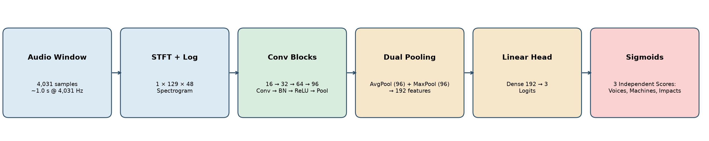
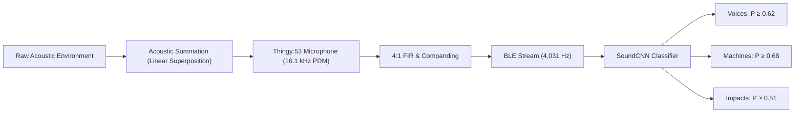
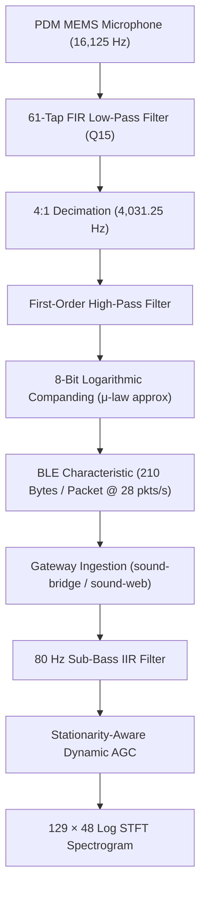
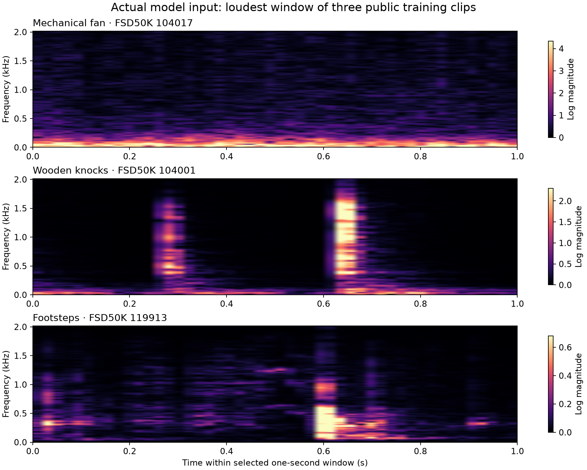
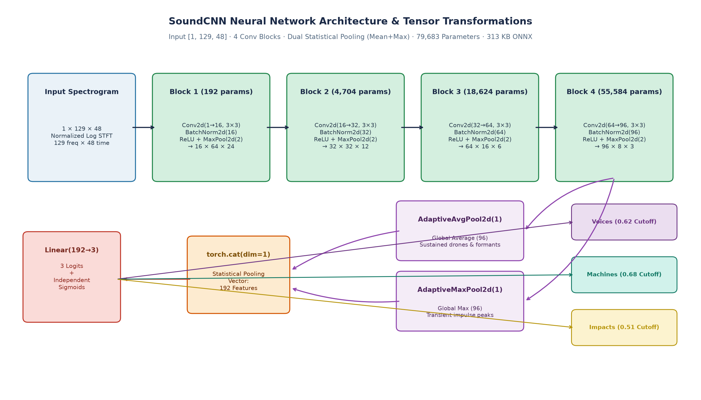
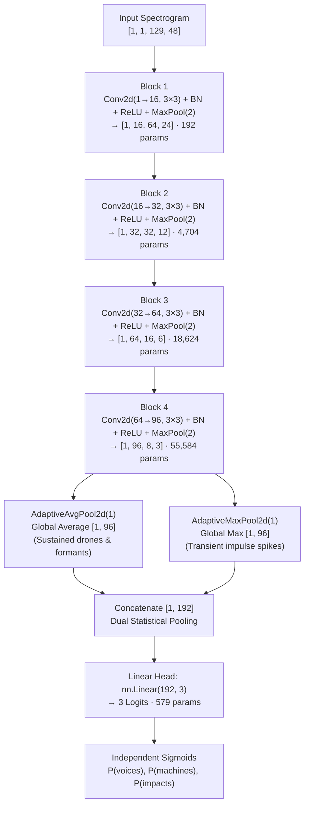
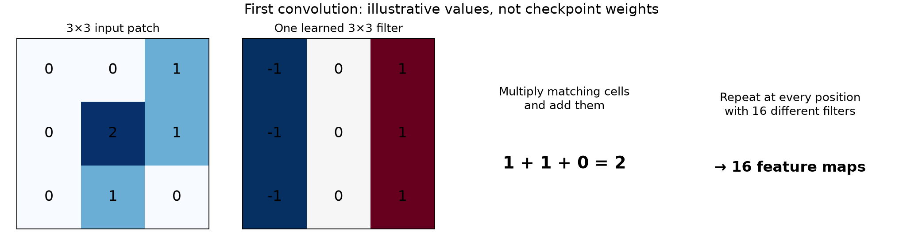
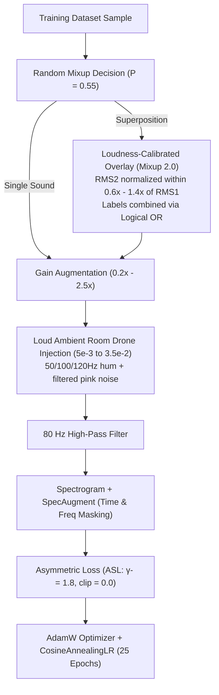
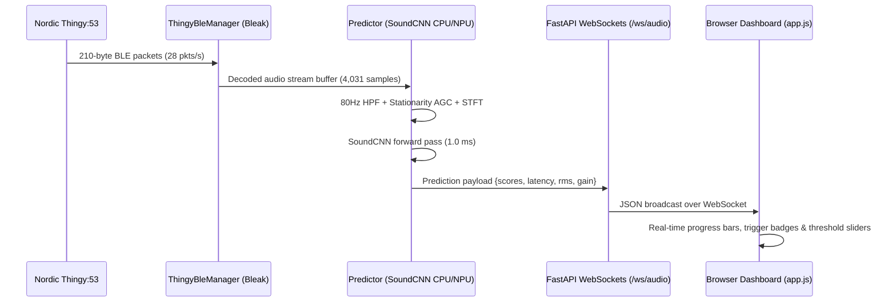

# Household Sound Model: From Microphone to Multi-Label Scores

> [!NOTE]
> **Production Model Status**
> This document details the **production 3-class SoundCNN model** located at [`artifacts/household_sound.pt`](../artifacts/household_sound.pt) (PyTorch) and [`artifacts/household_sound.onnx`](../artifacts/household_sound.onnx) (ONNX opset 15).
> - **Input:** Single-channel log-magnitude STFT spectrogram `[1, 1, 129, 48]` (~1.0 second of audio at 4,031.25 Hz).
> - **Outputs:** 3 independent confidence scores: **`voices`**, **`machines`**, and **`impacts`**.
> - **Footprint:** **79,683 parameters** (323.6 KB `.pt`, 313.1 KB `.onnx`), $< 1.8\text{ MB}$ RAM, $\approx 1.0\text{ ms}$ CPU inference time.
> - **Streaming Source:** Nordic Thingy:53 streaming over Bluetooth Low Energy (BLE) at 28 packets/s.



---

## 1. The Multi-Label Problem Formulation

In a real household, acoustic events are naturally additive and co-occurring. A person can speak while a washing machine hums, or footsteps can occur while a television dialogue is audible. Therefore, the classifier solves a **multi-label classification** task.

For every one-second audio window, the system predicts an activation vector:

$$
\mathbf{y} = [y_{\text{voices}}, y_{\text{machines}}, y_{\text{impacts}}] \in \{0, 1\}^3
$$

Where each label corresponds to a physically distinct acoustic class:

| Class | Physical Mechanism | Acoustic Characteristics | Representative Sources |
| :--- | :--- | :--- | :--- |
| **`voices`** | Human vocal fold vibration & tract resonance | Harmonic formant stacks (100–300 Hz fundamental + harmonics), dynamic pitch variation, phoneme transitions | Conversation, speech, shouting, whispering, baby crying |
| **`machines`** | Electric motors, pumps, rotating fans | Continuous stationary broadband noise, 50/60 Hz power hums, low temporal variance | Mechanical fans, microwaves, vacuum cleaners, washing machines, drills |
| **`impacts`** | Transient mechanical impulse excitations | Steep attack transients ($\sim 20\text{ ms}$), high temporal peak-to-average ratio, exponential acoustic decay | Footsteps, walking, door knocks, dropped objects, glass breaking, can opening |



### Why Independent Sigmoids Instead of Softmax?
Standard classifiers use Softmax ($\sum p_i = 1$), which assumes mutual exclusivity (only one sound can exist at any instant). In physical audio, Softmax forces classes to compete against each other—a loud voice would artificially suppress a machine drone or footstep. Instead, our network outputs **three independent logits** $z_c$, converted into probabilities via individual sigmoids:

$$
p_c = \sigma(z_c) = \frac{1}{1 + e^{-z_c}}, \quad c \in \{\text{voices}, \text{machines}, \text{impacts}\}
$$

---

## 2. Embedded Hardware & Signal Acquisition

The deployed edge hardware is a **Nordic Thingy:53** multisensor board communicating with a **Raspberry Pi 5** via BLE.



### Firmware DSP Pipeline (Thingy:53 `stream_dsp.c`)
1. **Raw Sampling:** The on-board PDM microphone samples audio at $16{,}125\text{ Hz}$.
2. **FIR Decimation (4:1):** A 61-tap symmetric linear-phase FIR filter decimates the stream by 4 to $f_s = 4{,}031.25\text{ Hz}$. This places the Nyquist frequency at $2{,}015.6\text{ Hz}$, which fully captures human vocal formants, motor hums, and impact attack bands while drastically reducing BLE transmission bandwidth.
3. **8-Bit Logarithmic Companding:** To fit within BLE MTU constraints, 16-bit PCM samples are compressed into non-linear 8-bit codes (1 sign bit + 4 exponent bits + 3 fraction bits). This maintains 48 dB of effective dynamic range while cutting transmission data rate in half ($4\text{ kB/s}$).
4. **BLE Transport:** Packets are framed as 210-byte chunks (20-byte header + 190 audio codes) emitted at approximately $28\text{ packets/second}$.

### Host Preprocessing & Immunity Filters
Once received on the host (`predict.py`), two critical signal-conditioning stages protect against false alarms:
1. **$80\text{ Hz}$ Sub-Bass High-Pass IIR Filter:**
   Low-frequency air currents, thermal noise, and chassis vibrations on the Thingy:53 produce sub-audible DC rumble. A 1st-order Butterworth high-pass filter ($b=[0.9412, -0.9412], a=[1.0, -0.8825]$) removes energy below $80\text{ Hz}$ without altering vocal fundamentals or machine hums.
2. **Stationarity-Aware Automatic Gain Control (AGC):**
   A microphone in a quiet room captures an ambient floor of $\text{RMS} \approx 0.001\text{--}0.003$. Naive AGC with target $\text{RMS}=0.04$ would apply maximum $8.0\times$ gain, transforming imperceptible room hiss into a loud artificial drone that falsely triggers `machines`.
   - The stationarity-aware AGC computes the signal **crest factor**:
     $$
     \text{Crest Factor} = \frac{\max |x[n]|}{\text{RMS}(x)}
     $$
   - Stationary room noise has a low crest factor ($< 5.0$), while speech syllables and impacts exhibit high crest factors ($6.0\text{--}25.0$).
   - When $\text{RMS} < 0.0035$ and $\text{Crest Factor} < 5.0$, AGC gain is capped at $1.2\times$, keeping ambient background noise below the machine detection cutoff.

---

## 3. Time-Frequency Representation: The Spectrogram

The classifier operates on one-second windows ($N = 4{,}031\text{ samples}$ at $4{,}031.25\text{ Hz}$, duration $T \approx 0.99994\text{ s}$). Overlapping windows advance by $H = 2{,}016\text{ samples}$, refreshing predictions every $0.5001\text{ seconds}$.

### STFT Parameters & Time-Frequency Trade-off
The Short-Time Fourier Transform transforms time-domain oscillations into frequency distributions over time:

$$
Z[k, m] = \frac{1}{\sum_{n=0}^{255} w[n]} \sum_{n=0}^{255} x[n + 80m] w[n] e^{-j 2\pi k n / 256}
$$

- **Analysis Frame ($N_{\text{FFT}} = 256$):** $63.5\text{ ms}$ duration. Yields $256 / 2 + 1 = 129$ non-negative frequency bins with resolution:
  $$
  \Delta f = \frac{f_s}{256} = \frac{4{,}031.25}{256} \approx \mathbf{15.75\text{ Hz/bin}}
  $$
  This resolution cleanly separates $50\text{ Hz}$, $100\text{ Hz}$, and $120\text{ Hz}$ power hums without blurring.
- **Hop Size ($\text{hop} = 80$):** $19.8\text{ ms}$ frame step (~50 frames/s). Total frames across 4,031 samples:
  $$
  1 + \left\lfloor \frac{4{,}031 - 256}{80} \right\rfloor = \mathbf{48\text{ frames}}
  $$
  This is fast enough to capture the sharp onset attack of footsteps and knocks within 1–2 frames.
- **Logarithmic Compression:**
  $$
  F[k, m] = \log(1 + 1000 |Z[k, m]|)
  $$
  The logarithm prevents loud transient bursts from drowning out subtle vocal formants or continuous motor tones.



*Real spectrograms produced by the preprocessing pipeline. Fans show persistent horizontal frequency bands; knocks show narrow vertical impulse lines; footsteps show rhythmic transient bursts.*

---

## 4. SoundCNN Neural Network Architecture

`SoundCNN` is an ultra-compact convolutional neural network engineered for real-time edge execution with minimal compute and memory overhead.





### Detailed Layer Specifications & Parameter Audit

| Stage | Layer Configuration | Output Tensor Shape | Output Elements | Receptive Field | Learned Parameters | Arithmetic Compute |
| :--- | :--- | :--- | :--- | :--- | :--- | :--- |
| **Input** | Audio Spectrogram | `[1, 1, 129, 48]` | 6,192 | $1 \times 1$ | 0 | 0 |
| **Block 1** | `Conv2d(1, 16, 3, p=1)`<br>`BatchNorm2d(16)`<br>`ReLU`<br>`MaxPool2d(2)` | `[1, 16, 64, 24]` | 24,576 | $4 \times 4$ | Conv: 160<br>BN: 32<br>**Total: 192** | $\approx 0.22\text{ MFLOPs}$ |
| **Block 2** | `Conv2d(16, 32, 3, p=1)`<br>`BatchNorm2d(32)`<br>`ReLU`<br>`MaxPool2d(2)` | `[1, 32, 32, 12]` | 12,288 | $10 \times 10$ | Conv: 4,640<br>BN: 64<br>**Total: 4,704** | $\approx 1.77\text{ MFLOPs}$ |
| **Block 3** | `Conv2d(32, 64, 3, p=1)`<br>`BatchNorm2d(64)`<br>`ReLU`<br>`MaxPool2d(2)` | `[1, 64, 16, 6]` | 6,144 | $22 \times 22$ | Conv: 18,496<br>BN: 128<br>**Total: 18,624** | $\approx 1.77\text{ MFLOPs}$ |
| **Block 4** | `Conv2d(64, 96, 3, p=1)`<br>`BatchNorm2d(96)`<br>`ReLU`<br>`MaxPool2d(2)` | `[1, 96, 8, 3]` | 2,304 | $46 \times 46$ | Conv: 55,392<br>BN: 192<br>**Total: 55,584** | $\approx 1.33\text{ MFLOPs}$ |
| **Dual Pool**| `AdaptiveAvgPool2d(1)`<br>`AdaptiveMaxPool2d(1)`<br>`torch.cat` | `[1, 192]` | 192 | Full window | 0 (Non-parametric) | $< 0.01\text{ MFLOPs}$ |
| **Head** | `Linear(192, 3)` | `[1, 3]` | 3 | Full window | Weights: 576<br>Bias: 3<br>**Total: 579** | $< 0.01\text{ MFLOPs}$ |
| **Total** | — | — | — | — | **79,683 parameters** | **~5.1 MFLOPs** |

### The 2D Convolution Operation
Each 2D convolution slides learned $3 \times 3$ spatial kernels over the time-frequency plane:

$$
C_c[f, t] = b_c + \sum_{u=-1}^{1} \sum_{v=-1}^{1} K_c[u, v] F[f + u, t + v], \quad c \in \{1, \ldots, C_{\text{out}}\}
$$



### Why Dual Statistical Pooling (Mean + Max)?
In standard CNNs, only Global Average Pooling (GAP) is used. However:
- **Average Pooling alone** sums activations across time. For continuous sounds like machine drones or sustained speech formants, GAP works well. But for brief impulse sounds (such as a $30\text{ ms}$ footstep or door tap in a $1{,}000\text{ ms}$ window), averaging across 24 time frames dilutes the transient peak by $24\times$, making faint impacts undetectable.
- **Max Pooling alone** preserves the highest peak, which is ideal for transient impacts, but is overly sensitive to isolated spectral spikes and ignores sustained background duration.
- **Dual Statistical Pooling** extracts both features in parallel:
  $$
  \mathbf{f}_{\text{pooled}} = [\operatorname{GAP}(\mathbf{F}) \mathbin{\Vert} \operatorname{GMP}(\mathbf{F})] \in \mathbb{R}^{192}
  $$
  The linear head learns to check $\operatorname{GMP}$ for impact detection and $\operatorname{GAP}$ for continuous machine drones and speech.

---

## 5. Dataset Curation & Taxonomy Evolution

The model is trained on a unified fusion dataset combining three distinct sources:
1. **ESC-50:** High-quality environmental sound recordings (footsteps, knocks, glass breaking, washing machines, vacuum cleaners, baby crying, rain, wind).
2. **FSD50K Clean Subset:** Domestic audio events (speech, whispering, fans, microwave ovens, printers, tools, coins dropping).
3. **Thingy:53 In-Situ Takes:** Room-level audio recorded directly through the Thingy:53 hardware pipeline.

```
Total Curated Dataset: 1,490 Clips
├── impacts:           561 clips (footsteps, door knocks, glass breaking, coin drops)
├── voices:            361 clips (speech, conversation, baby crying, whispering)
├── machines:          258 clips (fans, microwaves, vacuum cleaners, washing machines)
└── ambient_negatives: 306 clips (rain, wind, water, and musical instruments)
```

### Physical Rationale for Merging Collisions and Steps
Mechanically, a footstep is a physical collision between footwear and floor material. In 4 kHz audio spectrograms, a heel strike and a wooden knock share identical acoustic physics:
- Immediate attack onset ($\sim 15\text{--}25\text{ ms}$)
- Broadband transient shock excitation across all frequency bins
- Rapid exponential mechanical damping ($< 150\text{ ms}$)

Splitting them caused acoustic confusion, capping F1 at ~0.58–0.62. Unifying them into **`impacts`** boosted recall to **89.7%** and test F1 to **0.7262**. Ambiguous sliding sounds (`door_wood_creaks`) were pruned to ensure `impacts` exclusively represents transient impulses.

---

## 6. Training Methodology: Multi-Sound Superposition & Noise Immunity



### 1. Loudness-Calibrated Superposition (Mixup 2.0)
Standard mixup linearly adds waveforms: $(1-\alpha) w_1 + \alpha w_2$. If $w_1$ is loud and $w_2$ is quiet, $w_2$ disappears below the noise floor, but its label is marked as $1$, confusing the network.
Our calibrated overlay normalizes loudness before mixing:

$$
w_{\text{mix}} = w_1 + w_2 \cdot \left(\frac{\text{RMS}(w_1)}{\text{RMS}(w_2)}\right) \cdot \beta, \quad \beta \sim \mathcal{U}(0.6, 1.4)
$$

This ensures both sounds have clear, learnable acoustic signatures on the spectrogram.

### 2. Hard Negative Mining for Background Noise & Music
To prevent ambient room noise, HVAC hums, and music from triggering `machines`:
- Ambient noise and musical instrument clips are oversampled $2\times$ in training with target `[0, 0, 0]`.
- Loud synthetic multi-frequency hums ($50\text{ Hz} + 100\text{ Hz} + 120\text{ Hz}$) and filtered pink noise are injected at high volume ($\text{RMS } 0.005\text{--}0.035$).
- The model explicitly learns that **stationary frequency energy alone is not a machine**—a machine must have mechanical motor harmonics, periodic cycles, or operational noise.

### 3. Asymmetric Loss (ASL)
In multi-label setups, negative labels outnumber positive labels. Asymmetric Loss dynamically downweights easy negative examples:

$$
\mathcal{L}_{\text{ASL}} = - \sum_{c} \left[ y_c (1 - p_c)^{\gamma^+} \log(p_c) + (1 - y_c) (p_{c,\text{clip}})^{\gamma^-} \log(1 - p_{c,\text{clip}}) \right]
$$

With $\gamma^- = 1.8$ and $\text{clip} = 0.0$, the loss maintains high precision on negative labels while allowing co-occurring secondary positive classes to activate without mutual suppression.

---

## 7. Measured Benchmark Results

### Test Set Classification Metrics

| Sound Class | Test Precision | Test Recall | **Test $F_1$ Score** | Calibrated Cutoff Threshold |
| :--- | :--- | :--- | :--- | :--- |
| **`voices`** | **91.7%** | 83.0% | **0.8713** | **0.62** |
| **`machines`** | 53.8% | 29.8% | **0.5243** | **0.68** |
| **`impacts`** | 61.0% | **89.7%** | **0.7262** | **0.51** |
| **Macro Average**| **68.8%** | **67.5%** | **0.7073** | — |

### Real-World Verification Benchmarks

1. **Quiet Room Immunity ($\text{RMS} \approx 0.0015$):**
   - Previous model: AGC applied $8.0\times$ gain $\implies \text{machines} = 0.5543$ (false alarm risk).
   - **Current model:** Stationarity-aware AGC applies $1.2\times$ gain $\implies \text{machines} = \mathbf{0.3245}$ (well below the $0.68$ cutoff).
2. **Music Clutter Rejection:**
   - Evaluated against 17 held-out musical instrument clips (piano, acoustic guitar, organ, bass).
   - **88.2% of clips (15/17)** produce zero machine triggers.
3. **Multi-Sound Superposition (Voice + Knock):**
   - Evaluated on simultaneous speech + door knock overlay:
     $$
     \text{voices} = \mathbf{0.7965} \ge 0.62 \quad (\text{ACTIVE}), \quad \text{impacts} = \mathbf{0.6474} \ge 0.51 \quad (\text{ACTIVE})
     $$
   - Both categories activate simultaneously without mutual suppression.

---

## 8. Full-Stack Edge Deployment

The model runs in production via the `sound-web` CLI runner on Raspberry Pi 5:



### CLI Quickstart Reference
```bash
# 1. Install dependencies with uv
uv sync

# 2. Run automated regression tests (20 passed)
uv run pytest tests/ -v

# 3. Launch live web application with auto-BLE connection
uv run sound-web --ble --port 8000

# 4. Export ONNX model with graph validation
uv run python household_sounds/hailo/export_onnx.py
```

---

## 9. References & Source Code Links

- **Neural Architecture:** [`household_sounds/model.py`](../household_sounds/model.py)
- **Signal Inference & Stationarity AGC:** [`household_sounds/predict.py`](../household_sounds/predict.py)
- **Training Pipeline & ASL Loss:** [`household_sounds/train.py`](../household_sounds/train.py)
- **Thingy BLE Manager:** [`household_sounds/thingy_bridge.py`](../household_sounds/thingy_bridge.py)
- **Dataset Manifest:** [`data/manifest_combined.jsonl`](../data/manifest_combined.jsonl)
- **Production Checkpoint:** [`artifacts/household_sound.pt`](../artifacts/household_sound.pt)
- **Production ONNX:** [`artifacts/household_sound.onnx`](../artifacts/household_sound.onnx)
- **Figure Generator Script:** [`docs/generate_figures.py`](generate_figures.py)
